# Design of Deva

## Table of Contents

- [What Deva Is](#what-deva-is)
  - [Its Purpose](#its-purpose)
  - [What Deva Owns](#what-deva-owns)
  - [What Deva Does Not Replace](#what-deva-does-not-replace)
- [How Deva Works](#how-deva-works)
  - [The Orchestrator and Specialists](#the-orchestrator-and-specialists)
  - [Current Concurrency Boundary](#current-concurrency-boundary)
  - [Runtime Configuration](#runtime-configuration)
  - [Stages and Checkpoints](#stages-and-checkpoints)
  - [State, Resume, and Staleness](#state-resume-and-staleness)
  - [Full Runs and Single-Stage Runs](#full-runs-and-single-stage-runs)
  - [The Branching Model](#the-branching-model)
- [Step-by-Step Guide](#step-by-step-guide)
  - [Before the Pipeline: Validate the Environment](#before-the-pipeline-validate-the-environment)
  - [Stage 0a: Setup Gate](#stage-0a-setup-gate)
  - [Stage 0b: Architecture Context](#stage-0b-architecture-context)
  - [Stage 1a: Story Intake](#stage-1a-story-intake)
  - [Stage 1b: Story Refinement](#stage-1b-story-refinement)
  - [Stage 2: Branch Setup](#stage-2-branch-setup)
  - [Stage 3: Build](#stage-3-build)
  - [Stage 4: QA and Test](#stage-4-qa-and-test)
  - [Stage 5: Acceptance Check](#stage-5-acceptance-check)
  - [Stage 6: Publish](#stage-6-publish)
  - [Stage 7: Regression](#stage-7-regression)
  - [Stage 8: Prepare Review Delivery](#stage-8-prepare-review-delivery)
  - [Stage 8c: Human Review](#stage-8c-human-review)
  - [Stage 8d: Stacked Integration](#stage-8d-stacked-integration)
  - [Stage 9: Reviewer Feedback Re-Extraction](#stage-9-reviewer-feedback-re-extraction)
  - [Stage 10: Documentation and Archive](#stage-10-documentation-and-archive)
- [Checkpoint Reference](#checkpoint-reference)
- [What a Successful Run Produces](#what-a-successful-run-produces)
- [Key Learning Points](#key-learning-points)
- [Base Sources](#base-sources)

## What Deva Is

Deva is the Dev Assistant: the primary, user-facing orchestrator for a structured software development lifecycle. A developer selects **Deva** in the VS Code Chat agent/mode picker and starts it with a Jira key, for example:

```text
work on PROJ-1234
```

Deva coordinates a story from initial context gathering through implementation, quality checks, regression testing, review preparation, human review, conditional stacked integration, reactive feedback, and final documentation. It does not try to perform every activity itself. Instead, it delegates each kind of work to a specialist agent and keeps the complete workflow coherent.

### Its Purpose

Deva exists to make story delivery:

- **Structured:** work follows an explicit sequence with known dependencies.
- **Resumable:** an interrupted run can continue from approved progress.
- **Reviewable:** the developer makes decisions at named checkpoints.
- **Traceable:** stage results, approvals, and artifacts are recorded per Jira story.
- **Specialized:** implementation, review, testing, acceptance validation, Git operations, and documentation are handled by focused agents.
- **Safe:** remote changes and other consequential actions occur only after their prerequisites and checkpoints are satisfied.

The result is guided automation rather than unattended automation. Deva advances the workflow, while the developer remains accountable for scope, decisions, and final quality.

### What Deva Owns

Deva is the only agent that owns the stateful end-to-end pipeline. Its responsibilities include:

- selecting the next eligible stage from the pipeline registry,
- checking stage dependencies and other preconditions,
- invoking the appropriate specialist,
- presenting specialist results to the developer,
- recording approved checkpoint outcomes,
- detecting when later changes make completed work stale,
- coordinating repair and retry loops,
- maintaining the story session and activity log,
- archiving the completed session after the final stage.

This ownership matters because a development story is more than a series of independent prompts. A later action, such as changing implementation after a failed regression, can invalidate earlier QA, test, or acceptance results. Deva keeps those relationships visible.

### What Deva Does Not Replace

Deva does not replace:

- the developer's judgment at checkpoints,
- the live Jira story as the source of requirements,
- project-specific instructions and architecture context,
- local and CI validation,
- human code review,
- human review and merge authorization for the direct pull request or stacked review pull requests,
- human review, approval, and merge of the feature-to-`develop` pull request, completed at C8c for direct mode or C8d for stacked mode.

It also does not make every specialist stateful. Specialist agents are designed as focused workers. Deva supplies their context, receives their results, and owns the continuity between them.

Deva does not resolve pipeline configuration. Setup Validator invokes the resolver skill to validate and materialize one workspace-scoped snapshot. Deva verifies only that the setup cache passed and the snapshot is current; specialists read their own named sections through the skill.

## How Deva Works

### The Orchestrator and Specialists

Deva works like a delivery coordinator for a small specialist team:

| Specialist | Main responsibility |
| --- | --- |
| Setup Validator | Materializes resolved configuration, validates the development environment, and writes the setup cache. |
| Architecture Bootstrapper | Establishes or checks shared architecture context. |
| Story Analyst | Reads Jira, discovers relevant code context, and refines the story. |
| Branch Manager | Creates or updates the feature and story branches. |
| Implementation Partner | Implements the approved story scope. |
| QA | Reviews the changed code for defects, resilience, and security concerns. |
| Tester | Creates and runs tests and measures coverage. |
| Acceptance Checker | Compares the implementation with every acceptance criterion and checks scope. |
| Branch Publisher | Verifies the suite and pushes the story branch. |
| Regression Runner | Collects the developer's explicit regression result. |
| Subbranch Extractor | Prepares direct or stacked review delivery and refreshes it after reviewer feedback. |
| Integration Publisher | Creates or reconciles the final stacked integration pull request and refreshes it after integration feedback. |
| Documenter | Produces the final story report. |

Skills support these agents with reusable procedures. For example, the pipeline-session skill defines how story state is managed, while code review, test generation, coverage, architecture, acceptance validation, and subbranch extraction each have their own focused skill.

The distinction is useful:

- **Agent:** owns a role or stage responsibility.
- **Skill:** describes a reusable way to perform a focused activity.
- **Deva:** connects those roles and activities into one governed story lifecycle.

Every nested specialist invocation is a durable handoff, not an inferred consequence of stage state. Deva records the intended specialist and mode before dispatch and records exactly one terminal outcome when that invocation returns, blocks, fails, or produces no usable result. Multiple modes and retries are separate attempts; an interrupted attempt may be recovered, but two attempts cannot overlap for the same managed transition.

An unpaired or contradictory handoff blocks checkpoint approval, another specialist dispatch, downstream progression, and archival. This ensures the workflow can distinguish work that actually ran from work that was merely planned, and can explain every retry without relying on conversational memory.

### Current Concurrency Boundary

The current managed workflow is deliberately serialized. For one Jira story, only one Deva controller may be actively dispatching or mutating pipeline state at a time. Within that controller, only one managed specialist handoff may remain open. Stages that are logically independent may retain separate results and share a later checkpoint, but their specialist invocations execute one at a time under the current file-backed session contract.

This boundary extends to the working checkout. Two mutating Deva runs must not operate concurrently in the same checkout, even for different Jira keys, because Git branch, index, and working-tree state are shared outside the per-Jira session files. Separate stories may run concurrently only when each has an isolated worktree or checkout and does not target the same external side effect. Read-only work may overlap only when its declared inputs and outputs do not conflict.

Pipeline Session mitigates accidental overlap by recording a handoff before dispatch, refusing another dispatch while any managed handoff is open, rechecking dependencies before mutation, pairing every handoff with one terminal result, verifying append-only history, and reconciling durable side-effect intent before retry. Duplicate, missing, contradictory, or uncertain evidence blocks progression rather than being guessed or overwritten.

These checks are fail-closed detection and recovery, not an atomic cross-chat lock. Two Deva chats can still race between reading and writing the file-backed state. The safe operating rule is therefore one active stateful Deva chat per Jira key and one mutating Deva run per checkout. Do not start a second controller to unstick a pending invocation; recover or terminate the existing handoff first.

When overlap is suspected, stop new dispatch and mutation, retain both chats, and inspect the story session, activity log, open handoff row, current branch and working tree, and any intended external operation. Choose one controller to resume only after the state owner reports a current, unambiguous lifecycle. Never repair the collision from chat memory or let both controllers retry. The target control-plane design replaces this operational serialization with run revisions and fenced attempts; until then, serialization is the correctness boundary.

### Runtime Configuration

Runtime configuration has one owner and one canonical representation:

1. A dedicated resolution boundary validates the framework baseline and any permitted team extension, then publishes one verified workspace-scoped snapshot.
2. Extension is bounded: team configuration may supply project data and supported additions, but it cannot weaken or replace framework governance.
3. Setup Validator is the sole materialization owner. Deva verifies readiness without resolving configuration itself, and each specialist consumes only the verified section needed for its capability.
4. Missing, malformed, or stale configuration returns the workflow to setup validation rather than allowing consumers to construct their own fallback view.
5. Governance remains an independent authority and is not part of runtime configuration composition.

Configuration composition preserves the authority and shape of the framework baseline. Extensions may refine supported project data or use declared additive extension points, but they cannot replace protected policy, lower mandatory safeguards, redefine baseline integrations through an unsupported path, or change a value into an incompatible kind. Invalid extensions fail before publication with an actionable setup result; the resolver never silently coerces them into a different meaning.

The published snapshot is a versioned contract rather than an unstructured configuration copy. It carries enough provenance and generation identity to prove which validated source set produced the resolved values, support compatibility checks as the contract evolves, and let consumers verify freshness without reopening or recomposing the original sources.

Publication is transactional. A candidate generation becomes canonical only after its structure and provenance are verified and the source set is confirmed not to have changed during resolution. Any validation, publication, or concurrency failure preserves the last verified snapshot and returns the workflow to setup validation rather than exposing a partial generation to consumers.

The snapshot is workspace-scoped rather than Jira-scoped. Runtime readiness tracks two related but distinct identities: one represents the complete set of inputs that determine whether environment validation may be reused, while the other represents the resolved configuration generation consumed by managed work. Keeping them distinct prevents a valid environment report from being mistaken for proof that the configuration itself is unchanged, or the reverse.

A managed story records the configuration generation under which its evidence was produced. On resume, a changed generation blocks silent reuse until the developer explicitly adopts it; adoption invalidates earlier evidence as required by the workflow.

### Stages and Checkpoints

A **stage** is a unit of pipeline work, such as intake, build, QA, or publish. Stages have dependencies and produce results.

Each managed stage declares the evidence product that represents its accepted result and the specialist that owns producing it. That declaration binds the stage to one canonical story artifact: a stage cannot start or complete when its evidence type has no recognized destination, and it cannot be complete while that artifact is missing, placeholder-only, malformed, or owned by a different capability.

When later work legitimately refines the same evidence, it replaces the canonical interpretation through the owning stage while preserving facts and decisions that remain required by the workflow. The session does not accumulate competing copies or infer a stage result from checkpoint notes, chat narration, branch state, or unrelated artifacts. This keeps downstream context packaging and completion checks aligned with the workflow definition.

A **checkpoint** is a human decision associated with progress through a stage. Checkpoints use stable identifiers such as `C1a`, `C4`, and `C8b`. The identifier makes the decision easy to record, resume, and discuss.

The usual pattern is:

1. Deva confirms the stage is eligible to run.
2. Deva marks the stage in progress and invokes its specialist.
3. The specialist returns a result to Deva.
4. Deva presents the result and the checkpoint decision to the developer.
5. Deva ends the turn and waits for a later developer message that explicitly resolves the checkpoint.
6. A registered advancing reply records the stage result and permits downstream work.
7. A registered revision reply causes revision, deferral handling, or a controlled stop while keeping the checkpoint pending.

Not every checkpoint means the same thing. Some collect information, some authorize the next stage, and some accept a generated artifact. What they share is that Deva does not silently decide on the developer's behalf. Every checkpoint is a hard turn boundary: its prompt lists the exact, human-readable advancing and revision phrases registered for that checkpoint, then ends the turn. Only a later top-level developer message consisting solely of one registered phrase resolves the gate. An advancing phrase approves the checkpoint; a revision phrase keeps it pending and routes its named correction or stop path. Checkpoint IDs remain internal state keys and never appear in the required reply. When Deva runs below another agent, the parent relays a returned checkpoint and stops; an assistant-authored reply, a synthetic user message created by a parent or subagent, autonomous-run wording, and a parent dispatch of the next specialist are not developer decisions. There are no synonyms, generic yes/no replies, bulk approvals, autonomous approvals, auto-confirmed, or derived completions.

Checkpoint presentation is atomic. Deva completes and verifies required state and progress-list updates before it begins the developer-visible checkpoint response, then emits the complete ledger, question, and registered replies as one uninterrupted plain-text final response. It performs no tool call during or after that response; an embedded tool result must never split the checkpoint block or its identifier.

Some checkpoints coordinate more than one durable transition. A shared-evidence gate may receive independently completed stage results but remains pending until every required sibling is complete and fresh. Partial results are retained and visible without publishing the combined approval early. Under the current serialization boundary, sibling work executes one handoff at a time while remaining logically independent and preserving one developer decision over the complete evidence set.

Other checkpoints authorize a consequential side effect before the owning stage can finish. In that pattern, the approval durably fixes the exact authorized plan, execution proceeds against that plan, and later reconciliation completes the stage without requesting or recording a second approval. If execution is interrupted, resume uses the existing authorization and performs only unfinished work; a changed plan requires a new developer decision. These composite patterns never let partial evidence or successful execution substitute for the checkpoint itself.

Every next specialist also enforces the boundary independently. On Jira-keyed entry, before it reads stage inputs, invokes another skill, runs commands, edits files, or mutates remote state, the specialist performs a read-only precondition check through the Pipeline Session skill for its own stage. It continues only when every registered dependency returns a valid registered decision reply; approval markers written by older framework versions remain readable for backward compatibility. Otherwise it returns the earliest pending checkpoint without doing stage work. Story Analyst maps its modes to the `intake` or `refine` stages, and Subbranch Extractor additionally requires `C8a` before extraction and `C8b` before publication. Keyless standalone runs keep their separate input and heavy-precondition contracts. This prevents a parent agent from bypassing any checkpoint by invoking the next specialist directly.

A checkpoint approval and its Jira milestone form one recoverable transition. The developer's decision and accepted local evidence become durable before external publication is attempted, but downstream progression waits until the Jira audit record is also confirmed. Each milestone has a stable identity, so a retry reuses or reconciles the existing publication rather than creating another comment or another approval.

If publication is interrupted or unavailable, the approved local decision remains intact while the workflow blocks at that boundary. Recovery verifies the durable decision and external record, repairs only the missing side of the transaction, and never asks Deva to replay the developer's message or synthesize a new approval. Duplicate or conflicting milestone evidence is a deterministic conflict that requires reconciliation before the next stage.

Every externally visible mutation is also treated as a recoverable side effect. The workflow records the intended target and stable operation identity before acting, then records the observed result or unresolved uncertainty immediately afterward. Progress is monotonic: later evidence may complete or reconcile an earlier intent, but it cannot erase the fact that an attempt occurred or silently redirect the authorization to a different target.

After interruption, the responsible specialist compares durable intent with the external system before deciding whether to continue. It reuses a confirmed result, completes only missing work, or reports a deterministic conflict; it does not blindly repeat Jira, branch, push, pull-request, comment, or superseded mutations. Unknown or contradictory side-effect state blocks stage completion and downstream work until reconciled.

Intake and refinement remain distinct. C1a approves the developer context and completes only `intake`; Story Analyst then runs `refine`, and C1b separately asks the developer to approve the implementation-ready understanding before branch setup.

### State, Resume, and Staleness

For a Jira-keyed run, Deva maintains a durable story session. The session records items such as:

- the current and last approved checkpoint,
- stage status,
- the source state from which a stage result was produced,
- important outputs from intake, QA, testing, acceptance, regression, and splitting,
- the actor and update time for each stage.

Checkpoint history is one canonical, workflow-ordered decision record. Every registered gate appears exactly once and retains its stable identity from initialization through completion. A transition updates the existing gate rather than creating a second interpretation of the same decision, and any duplicate, missing, reordered, or contradictory checkpoint evidence blocks progression until the session is reconciled. This keeps checkpoint state deterministic across retries, resume, and framework upgrades.

The complete story session represents one coherent workflow moment. Its active position, stage states, checkpoint decisions, approved artifacts, source evidence, and chronological audit must agree before a transition is considered durable. A stage cannot appear complete while its required decision is pending or its substantive result is absent, and the audit trail cannot lag behind a state change that the workflow presents as complete.

Every managed mutation preserves these relationships as one transition boundary. If a partial failure or external edit leaves the regions inconsistent, Deva stops before narration or downstream work and routes recovery through the state owner. It never selects the most convenient fragment, reconstructs missing evidence from chat memory, or advances while reconciliation is incomplete.

Deva also writes a chronological activity log containing stage entries, approvals, rejections, blocks, skips, and reruns.

The activity log is an append-only audit stream retained independently from the mutable story snapshot. Existing history is never rewritten, reordered, or truncated; retries recognize an already-recorded event rather than duplicating it. The stream may expose different levels of operational detail, but filtering affects visibility only and never changes the durable workflow state.

Audit integrity is part of transition integrity. Missing required lifecycle events, duplicate identities, out-of-order history, or evidence that earlier content was lost blocks progression and recovery until reconciled. The current session cannot be used to reconstruct or replace missing historical events, because state describes where the workflow is while the log records how it got there.

If a run is interrupted, Deva can offer to resume from approved progress or start fresh. Resume is not a blind jump to the last line written. Deva rechecks the environment, resolved-configuration fingerprint, and branch context, evaluates stage freshness, and reruns work whose inputs have changed.

If a run is interrupted while opening the approved draft pull requests, Deva resumes publication from the saved manifest. It checks what has already been completed and performs only the remaining work, without repeating split planning, branch extraction, or developer approval. Once publication is complete, the pipeline moves to human review.

This is **staleness propagation**. For example:

- a new implementation commit can make earlier QA and tests stale,
- a regression fix can make acceptance validation stale,
- a changed split source can make an earlier review manifest stale.

Each stage declares the evidence and upstream results on which its completion depends. A completed stage becomes stale when its own observed input changes, when a required upstream result becomes stale or is replaced, or when an accepted external artifact no longer represents the current story state. Invalidation then propagates only through dependent stages in the workflow graph; independent earlier work remains reusable.

Staleness is evidence-based rather than inferred from elapsed time or conversational memory. Every invalidation identifies the changed input and the affected downstream work, allowing resume to explain what must rerun, what remains approved, and why. A stale result cannot satisfy a dependency or checkpoint until refreshed evidence replaces it.

Only approved work becomes resumable state. Rejected output is not treated as completed progress.

The session contract is versioned so an interrupted story can survive framework evolution. Older sessions are interpreted through deterministic compatibility rules before eligibility or freshness is evaluated. Migration preserves recorded evidence and decisions, adds newly required structure conservatively, and never invents approval for a checkpoint that did not exist when the session was written. When a newer design introduces a human decision that historical state cannot prove, affected progress returns to an explicit pending or stale state rather than being treated as complete.

Compatibility conversion is non-destructive during inspection. Its normalized form becomes durable only as part of the next authorized state transition, so a read-only resume check cannot silently rewrite story history. A session that cannot be migrated without ambiguity blocks with an actionable recovery outcome instead of guessing.

### Full Runs and Single-Stage Runs

Deva supports two Jira-keyed modes:

- **Full run:** follows the complete pipeline, skipping only stages that are already complete and fresh.
- **Single-stage run:** runs one requested stage, after checking its registered dependencies and safety preconditions, and records the result for later reuse.

Examples of a single-stage request include running QA or an acceptance check for an in-progress Jira story. Because the result is recorded against the story, a later full run can reuse it while it remains fresh.

Without a Jira key, focused work belongs to the relevant specialist as a stateless task. It does not create pipeline state, record checkpoints, or become resumable Deva progress. There is no keyless stateful Deva pipeline.

### The Branching Model

Deva uses a two-layer branch model:

```text
develop
`-- feature/<user>/<PARENT-JIRA>
    `-- feature/<user>/story/<PARENT-JIRA>        canonical story branch
```

The story branch is the implementation source of truth. All implementation, QA fixes, test additions, acceptance fixes, regression repairs, reviewer corrections, and integration corrections land there first. Review subbranches are created only after the story is complete and regression has passed.

After regression, Deva partitions the complete feature-to-story diff into one or more mutually exclusive, acceptance-criteria-mapped slices. The approved review decomposition determines whether delivery follows a direct or stacked review path.

For exactly one slice, Deva uses the **direct review path**:

```text
develop
`-- feature/<user>/<PARENT-JIRA>              complete story result -> draft PR to develop
    `-- feature/<user>/story/<PARENT-JIRA>        canonical story source
```

- no review subbranch is created,
- the complete validated story result is copied into the feature branch with additive, non-rewriting history,
- the feature branch's tracked tree must equal the canonical story tree,
- one draft feature-to-`develop` pull request is opened for human review, and
- ordinary reviewer corrections land on the story branch first, rerun affected validation, and propagate additively to the feature branch and existing pull request; revert the feature integration only when the reviewer explicitly rejects the entire implementation.

For more than one slice, Deva uses the **stacked review path**:

```text
develop
`-- feature/<user>/<PARENT-JIRA>
    |-- feature/<user>/story/<PARENT-JIRA>        canonical story source
    `-- feature/<user>/story/<PARENT-JIRA>-PR1     Slice 1 -> feature branch
        `-- feature/<user>/story/<PARENT-JIRA>-PR2  Slices 1+2 -> PR1 branch
            `-- feature/<user>/story/<PARENT-JIRA>-PR3  Slices 1+2+3 -> PR2 branch
```

No Jira subtask or descriptive slug is created for a review slice. The parent Jira key plus the one-based PR ordinal determines each review branch. Slice scope remains descriptive manifest data rather than branch identity.

The extracted pull requests form one linear stack:

- the stack root targets the feature branch,
- each dependent subbranch targets its parent subbranch,
- each pull request initially shows only its mutually exclusive, acceptance-criteria-mapped slice,
- reviewers examine the incremental slices from the root upward so foundational work is understood before dependent work,
- after slice feedback is resolved, merge authorization proceeds from the tip toward the root: merge the current tip into its parent, revalidate and reapprove that changed aggregate parent, and repeat until the root carries the complete story,
- immediately before each merge, approval and required checks must match the live source and target revisions; a changed source or target makes earlier merge evidence stale,
- before the root pull request merges into the feature branch, its tracked tree must equal the canonical story branch's tracked tree,
- after the root merges into the feature branch and C8c approves the completed stack review, reactive Stage 8d automatically creates or reconciles the draft feature-to-`develop` pull request with the full stack evidence; humans retain review, approval, and merge control,
- the story branch is not rewritten to create the stack,
- published review branches are never rebased, force-pushed, or otherwise rewritten,
- merge commits preserve stack ancestry; squash or rebase merges are not used for stack collapse.

This conditional model avoids stack overhead for a one-slice story while preserving three concerns for multi-slice work: building the story coherently, presenting it to reviewers in manageable slices, and integrating the fully collapsed feature into `develop` through one protected-branch pull request.

## Step-by-Step Guide

The main control flow runs from top to bottom. Nodes marked **hard stop** wait for an exact registered developer reply before Deva continues. Side branches show the conditional review path and the reactive correction loops.

```mermaid
flowchart TD
  setupValidator["Run Setup Validator independently"] --> setupCache{"Current PASS cache?"}
  setupCache -- No --> validate["Materialize configuration and validate environment"]
  validate --> validationOutcome{"Validation result"}
  validationOutcome -- PASS --> startDeva["Developer starts or resumes Deva"]
  validationOutcome -- BLOCKER --> setupBlocked["Return blocker and wait for developer resolution"]
  setupBlocked -- developer resolves and reruns --> setupValidator
  setupCache -- Yes --> startDeva
  startDeva --> c0a["Stage 0a: Setup gate<br/>C0a hard stop"]

  c0a -- run architecture --> architecture["Stage 0b: Bootstrap or assess architecture"]
  c0a -- skip architecture --> architectureSkipped["Record intentional architecture skip"]
  architecture --> c0b["C0b hard stop"]
  architectureSkipped --> c0b

  c0b --> intake["Stage 1a: Story intake<br/>C1a hard stop"]
  intake --> refine["Stage 1b: Story refinement<br/>C1b hard stop"]
  refine --> branch["Stage 2: Branch setup<br/>C2 hard stop"]
  branch --> implement["Stage 3: Build<br/>C3 hard stop"]
  implement --> quality["Stage 4: QA and tests<br/>C4 shared hard stop"]
  quality --> acceptance["Stage 5: Acceptance check<br/>C5 hard stop"]
  acceptance --> publish["Stage 6: Publish story branch<br/>C6 hard stop"]
  publish --> regression["Stage 7: Developer regression<br/>C7 hard stop"]

  regression -- regression failed --> repair["Repair story branch and refresh stale evidence"]
  repair --> quality
  regression -- regression passed --> splitPlan["Stage 8: Review plan<br/>C8a hard stop"]
  splitPlan --> deliveryMode{"Approved slice count"}

  deliveryMode -- One --> direct["Prepare direct feature-to-develop delivery<br/>C8b hard stop"]
  deliveryMode -- More than one --> stacked["Prepare ordinal review stack<br/>C8b hard stop"]
  direct --> directReview["Stage 8c: Human review and direct integration<br/>C8c hard stop"]
  stacked --> stackReview["Stage 8c: Human review, collapse, and feature landing<br/>C8c hard stop"]

  directReview -- review changes requested --> reviewRepair["Repair story and refresh QA, tests, acceptance, publish, and regression"]
  stackReview -- review changes requested --> reviewRepair
  reviewRepair --> reextract["Stage 9: Refresh approved delivery<br/>C9 hard stop"]
  reextract -- accept revised delivery --> reviewMode{"Delivery mode"}
  reviewMode -- Direct --> directReview
  reviewMode -- Stacked --> stackReview
  reextract -- revise delivery --> reviewRepair
  reextract -- restart review preparation --> splitPlan

  stackReview -- review complete --> integration["Stage 8d: Publish stacked integration PR<br/>C8d hard stop"]
  integration -- integration changes requested --> integrationRepair["Repair story and refresh existing integration PR"]
  integrationRepair --> integration
  integration -- restart review preparation from integration --> splitPlan

  directReview -- review complete --> docs["Stage 10: Generate Post-Action report<br/>C10 hard stop"]
  integration -- integration complete --> docs
  docs -- archive session --> archive["Archive session, retain activity log, and update reuse index"]
```



### Before the Pipeline: Validate the Environment

Before the first story run, use the Do It menu and choose **Validate my environment**. Setup Validator first checks for a reusable setup cache. A current PASS is returned verbatim with no further work. When the cache is missing or stale, or the developer explicitly requests revalidation, Setup Validator materializes and verifies the canonical resolved-configuration snapshot, then checks prerequisites such as required connectivity, authorization readiness, nested-agent support, AI co-author configuration, and Git working state. It writes a reusable setup-validation cache when validation succeeds.

Readiness evidence is reusable only while both of its freshness conditions hold: the validated input set still has the same identity, and the evidence remains within the configured validity period. A relevant input change invalidates reuse immediately even when the result is recent; expiration requires revalidation even when the inputs are unchanged. The developer may also request revalidation explicitly. This prevents elapsed time and source identity from being treated as interchangeable safety signals.

Deva verifies the reusable setup result and current configuration without silently repeating validation or resolution. Missing, malformed, stale, or failed readiness evidence returns the developer to setup validation. A valid result allows Deva to surface C0a only; it does not authorize architecture work in the same turn.

**Learning point:** environment validation is a reusable preflight, not story implementation work. Fixing setup before intake prevents later stages from failing for unrelated reasons.

### Stage 0a: Setup Gate

**Registry stage:** `setup`

**Purpose:** confirm that the environment has already passed standalone validation and decide whether to run the optional architecture stage.

Deva verifies the setup cache and gathers the minimum story identity needed to begin a stateful run. Once setup is valid, it marks setup in progress, offers the architecture bootstrap decision at C0a, and ends the turn. Architecture cannot start until a later developer response explicitly approves C0a.

#### Checkpoint C0a: Architecture Decision

The developer chooses whether to run or skip architecture bootstrap for this run.

- **Run it** when architecture context is absent or when a refresh should be considered.
- **Skip it** when the developer intentionally wants to proceed without the potentially expensive architecture trace.

Skipping is an explicit choice, not a hidden failure. The story can continue to intake.

The choice to skip controls whether the Architecture Bootstrapper runs; it does not approve C0b. Deva must still surface C0b in a later prompt before intake can begin.

**Output:** a valid setup gate and a recorded architecture-stage decision.

### Stage 0b: Architecture Context

**Registry stage:** `architecture`

**Purpose:** give downstream agents a shared, evidence-based view of the codebase.

If canonical architecture metadata is absent, the Architecture Bootstrapper performs a deep bootstrap across every confirmed in-scope repository. It publishes the architecture baseline and derived views only after discovery coverage is complete. An incomplete bootstrap returns a generation-failed outcome and leaves the canonical metadata absent, preventing partial results from being treated as a trusted baseline.

If metadata already exists, the stage normally performs a read-only drift scan. Metadata without complete discovery coverage is treated as an unverified baseline and causes the stage to propose a one-time, consent-gated baseline refresh. Otherwise, refresh is proposed only when accumulated drift crosses the configured threshold. No meaningful drift, or a declined refresh, becomes a successful no-op rather than a pipeline blocker.

Before presenting a refresh choice, Deva persists the exact proposed operation and its choices in the Pipeline Session. A later developer reply is recorded against that unchanged proposal before any architecture artifact is refreshed or the decline path advances. This makes interruption distinguish an undecided proposal from an authorized or declined refresh.

Efficient drift assessment relies on a version-control baseline paired with the architecture context. For every confirmed in-scope repository, the baseline records the repository identity, inclusion status, default branch, and observed revision from the last complete architecture generation. Later assessment compares current repository state with that generation and reports changed repositories, available change magnitude, architecture-significant paths, and indeterminate evidence without rewriting architecture artifacts.

The baseline accelerates assessment; it does not replace deep discovery. Missing, incomplete, placeholder, or unreadable baseline evidence cannot support a trusted no-change decision and instead leads to a consented bootstrap or refresh. A successful refresh re-establishes the baseline only after complete discovery, while preserving repository metadata owned by other framework concerns.

Architecture ownership is intentionally narrow:

- this stage is the only writer of the architecture artifact set,
- intake and implementation consume the artifacts without regenerating them,
- authored documentation is preserved during refresh,
- architecture-significant implementation changes are reported for a future architecture-stage refresh.

The machine-readable architecture context is the canonical factual source; workspace guidance, architecture and data-model narratives, diagrams, and repository baselines are derived views for different audiences. A refresh reconciles those views with materially changed facts without turning the narratives into separate competing sources of architecture truth.

Automatic workspace-guidance population is scaffold-aware. A section may be filled automatically only while it remains an untouched placeholder and traced evidence supports the content. Any substantive human-authored text makes the section authored content, which is preserved unless the developer explicitly requests a refresh. Updates are section-scoped and integrate changed facts while retaining unaffected explanation, structure, and intentional local guidance.

#### Checkpoint C0b: Architecture Ready

The developer confirms that the architecture stage has completed, been skipped as requested, been refreshed with consent, or safely resulted in no change, and allows story intake to begin. C0b is always surfaced, including when architecture artifacts already exist or the developer chose skip at C0a. Deva ends the turn and waits for a later explicit response before completing the architecture stage or starting intake.

**Output:** shared architecture context, or a recorded intentional skip/no-op.

### Stage 1a: Story Intake

**Registry stage:** `intake`

**Purpose:** turn a live Jira ticket and local codebase evidence into a grounded understanding of the work.

The Story Analyst reads the story's summary, description, acceptance criteria, comments, and linked context. It examines the workspace for likely repositories, files, patterns, and dependencies. Every keyed intake performs mandatory local-first discovery across retained story history, with a fallback when the primary catalog is unavailable or incomplete.

The search then federates across Jira relationships, architecture documents, live repository evidence, and available relevant internal sources such as Confluence, Stack Overflow, and approval-gated <BASE_ENGINEERING_ECOSYSTEM>. Remote-source availability is non-blocking, but each outcome is explicit. Prior work is never reused silently: candidates are summarized for developer approval first, and C1a cannot complete without persisted search evidence and an approved, trimmed, rejected, or none-found reuse decision.

The analyst returns targeted questions rather than inventing missing context. Typical topics include:

- affected repositories and files,
- existing libraries or patterns to reuse,
- base branch choice,
- definition of done,
- risks, dependencies, and known gotchas,
- whether suggested prior art is relevant.

#### Checkpoint C1a: Developer Context

The developer answers the intake questions and approves or rejects any proposed prior-art reuse.

This checkpoint supplies the context that the ticket and repository alone cannot prove. The answers become controlled inputs to refinement and implementation.

**Output:** a grounded intake record containing requirements, discovered context, developer agreements, boundaries, explicit source-by-source prior-art search evidence, and the approved/trimmed/rejected/none-found reuse decision. Refinement preserves that evidence and decision rather than replacing it with an untraceable summary.

### Stage 1b: Story Refinement

**Registry stage:** `refine`

**Purpose:** convert intake findings into a clear, implementation-ready agreement.

The Story Analyst consolidates the objective, acceptance criteria, scope, out-of-scope boundaries, dependencies, repositories, key files, base branch, and implementation-ready actions. It assesses whether the story is sufficiently refined and resolves material ambiguity with the developer.

When that assessment identifies material refinement gaps, the developer chooses whether to improve the proposed agreement or proceed with the gaps explicitly recorded. Requests for examples or further explanation keep this decision pending rather than advancing the stage.

The original Jira description is preserved when the story is enriched. Added sections capture context, understanding, scope, agreements, and prompt-ready actions so downstream agents receive a stable brief.

Enrichment is a separate, explicit authorization decision. The developer may authorize the update or decline it and return to refinement; neither choice substitutes for confirming the resulting understanding at C1b. These refinement and enrichment decisions are intra-stage hard stops that occur before the stage-completion checkpoint.

#### Checkpoint C1b: Confirm Understanding

The developer confirms that the consolidated understanding matches the intended story. Missing or incorrect details are corrected before branch creation.

This is a separate hard stop after C1a, not an automatic continuation of intake. Deva ends the turn at C1b and waits for explicit developer approval before branch preparation. This is a high-value checkpoint because later technical quality cannot compensate for implementing the wrong scope.

**Output:** a confirmed, prompt-ready story brief and an enriched Jira description.

### Stage 2: Branch Setup

**Registry stage:** `branch`

**Purpose:** establish the Git branches on which the story will be implemented.

Before proposing branch names, Deva derives the branch owner segment from the repository's configured author identity using the framework's canonical naming policy. A missing identity uses a documented neutral fallback; a malformed or unsafe identity blocks branch setup rather than being inferred from unrelated environment, account, or remote metadata.

Deva validates the complete feature and story branch names before presenting them for developer approval. Branch Manager independently verifies the identity derivation and branch-name validity immediately before any Git mutation, and only the exact approved proposal may be applied.

The Branch Manager owns the Git operations. The exact flow depends on the approved base branch:

- From `develop`, it creates or prepares `feature/<user>/<PARENT-JIRA>`, then creates `feature/<user>/story/<PARENT-JIRA>` from it.
- From an existing feature branch, it first brings that branch up to date using non-rewriting operations, then creates the canonical namespaced story branch from it.

Before dispatch, Deva persists the exact base, feature branch, story branch, and remote push proposal. Branch Manager may mutate Git only after a later developer reply authorizes that unchanged proposal; a requested plan change returns to proposal without mutation.

This authorization is an intra-stage hard stop before any branch or remote side effect. It approves only the unchanged branch plan; C2 remains the separate stage-completion checkpoint that confirms branch preparation succeeded and implementation may begin.

Missing branches, merge conflicts, dirty work that prevents safe setup, or rejected pushes block the stage. Deva does not bypass those conditions or rewrite published history.

#### Checkpoint C2: Story Branch Ready

The developer confirms that the correct story branch is ready and authorizes implementation to begin.

**Output:** the prepared feature/story branch relationship and the story branch checked out for work.

### Stage 3: Build

**Registry stage:** `implement`

**Purpose:** implement the confirmed story on the story branch.

The Implementation Partner reads the agreed story brief, project instructions, architecture context, and nearby code patterns. It makes scoped production changes, adds appropriate validation, and runs focused checks as work progresses.

Most stories use one Implementation Partner. Deva may propose a multi-stream implementation plan only when the work can be divided into genuinely independent streams with disjoint file ownership, or when the developer explicitly requests it. The plan preserves stream ownership and dependencies, but the current controller dispatches its managed Implementation Partner handoffs one at a time in the shared checkout. All streams still contribute to the same story branch, and Deva remains responsible for integration and progress tracking. Actual overlapping execution requires isolated worktrees plus the target fenced-transition contract and is not part of the current design.

Implementation follows several principles:

- preserve existing project patterns and public contracts unless the story requires a change,
- keep changes within the confirmed scope,
- validate the smallest useful slice after edits,
- handle errors consistently,
- do not create review subbranches yet,
- report architecture-significant changes rather than rewriting architecture artifacts.

Implementation begins from the prior-art set curated and approved during intake; it does not independently reopen broad local-history discovery. When a concrete technical gap, unfamiliar platform behavior, build failure, or test error arises, Implementation Partner may perform a targeted read-only lookup across available internal documentation, Q&A, and shared-library sources. These lookups supplement the approved story context rather than replacing Story Analyst's curation role.

Research is bounded, source-attributed, and treated as untrusted technical assistance. Implementation Partner verifies every suggested pattern or fix against the current codebase and authoritative project context. A sourced proposal within the confirmed agreement is not adopted silently: the partner pauses the affected implementation scope, returns the proposal and evidence to Deva, and resumes only after the developer approves or declines it. Specialist research success alone never completes the implementation stage.

When research changes the confirmed agreement rather than only the technical approach, implementation stops before adoption. Story Analyst produces a focused revised agreement, the original C1b approval remains in immutable history, and the developer separately confirms the revision. An accepted revision updates the canonical understanding, is enriched back to Jira, and invalidates affected downstream evidence before implementation resumes; a rejected revision preserves the current agreement and requires an in-scope alternative or blocker.

#### Checkpoint C3: Implementation Complete

The developer reviews the implementation summary and decides whether the story is ready for whole-branch QA and testing or needs more implementation work.

**Output:** a complete candidate implementation on the story branch, with focused validation evidence.

### Stage 4: QA and Test

**Registry stages:** `qa` and `tests`

**Purpose:** review the same story branch from two complementary quality perspectives.

Once the build is approved, QA and Tester are logically independent because neither depends on the other's result. In the current file-backed workflow, Deva runs their managed handoffs one at a time and retains each result under the shared C4 gate. The target control plane may execute them concurrently once fenced attempts and isolated mutation boundaries exist.

**QA** performs a read-only review focused on issues such as:

- logic defects and edge cases,
- null and error handling,
- resource and reliability risks,
- security concerns,
- maintainability and project-convention mismatches.

**Tester** creates and runs deterministic tests focused on:

- success paths,
- boundary and edge cases,
- error paths,
- realistic assertions,
- boundary-only mocking,
- the configured overall and business-logic coverage targets.

Deva combines both results into one quality decision. Findings are prioritized, relevant fixes are applied on the story branch through the implementation flow, and the affected checks are rerun until the result is suitable for acceptance validation.

#### Checkpoint C4: Quality Results

`C4` is shared by the `qa` and `tests` stages. The developer reviews both outputs together and decides whether to accept the combined quality evidence and proceed to acceptance, or apply the recommended fixes and repeat the affected checks.

The shared checkpoint prevents Deva from treating review findings and test evidence as unrelated approvals.

**Output:** QA findings, a test report, coverage evidence, and any approved fixes on the story branch.

### Stage 5: Acceptance Check

**Registry stage:** `acceptance`

**Purpose:** determine whether the implemented story satisfies the agreement confirmed during intake and refinement.

The Acceptance Checker evaluates each acceptance criterion against code and test evidence. It also checks for scope creep. Each criterion receives one of four outcomes:

- **Met:** evidence shows the criterion is satisfied.
- **Partially Met:** some required behavior or evidence is missing.
- **Not Met:** the implementation does not satisfy the criterion.
- **Deviated:** implementation differs from the stated criterion under a documented agreement.

The check distinguishes technical quality from requirement completeness. A clean QA review and passing tests do not, by themselves, prove that the requested behavior was built.

#### Checkpoint C5: Acceptance Decision

If all criteria are met, the developer approves progression to publishing and regression. If gaps or deviations exist, the developer decides whether to fix them now or explicitly defer them.

Fixes return to the story branch and can make quality results stale, causing the necessary QA, test, and acceptance checks to run again.

**Output:** an acceptance-criteria status table and a scope-alignment decision.

### Stage 6: Publish

**Registry stage:** `push`

**Purpose:** publish the validated story branch so regression can proceed against shared code.

The Branch Publisher first runs the configured local automated suite. Publishing is blocked if that suite is not green. When validation succeeds, it pushes the canonical `feature/<user>/story/<PARENT-JIRA>` branch to the remote.

No review subbranches or pull requests are created at this point. Publishing the source-of-truth story branch and decomposing it for review are deliberately separate stages.

Publish evidence is durable before the developer is asked to accept the stage. Branch Publisher returns one canonical account of the remote branch, observed revision, validation result, and safety outcome; Deva validates and stages that account while publish remains in progress. C6 then accepts and promotes the same evidence rather than reconstructing it from a checkpoint note, conversational memory, or a later inspection of Git.

The candidate is revalidated at acceptance because the branch, report, or safety facts may have changed while the checkpoint was waiting. Missing, malformed, stale, or inconsistent publish evidence leaves C6 pending and blocks regression. This two-phase boundary lets an interrupted run resume with the exact result the developer was shown without treating specialist success alone as checkpoint approval.

#### Checkpoint C6: Story Branch Published

The developer confirms that the story branch has been pushed and authorizes regression testing.

**Output:** a remote story branch containing the accepted implementation and tests.

### Stage 7: Regression

**Registry stage:** `regression`

**Purpose:** obtain an explicit developer result from the relevant regression workflow.

The Regression Runner first returns the required regression checklist for Deva to present. After the developer responds in the main chat, Deva re-invokes the same runner with the persisted round identity and unchanged response so the runner, rather than Deva, produces the canonical pass/fail result. It does not fabricate a pass and does not own repairs.

#### Checkpoint C7: Regression Result

The developer reports **pass** or **fail** with useful evidence.

- On **pass**, the story is eligible for review decomposition.
- On **fail**, Deva coordinates the repair on the story branch, reruns affected QA and tests, rechecks acceptance as needed, republishes, and requests another regression result.

The loop has a configured retry budget. In a stateful run, each retry is consumed under a stable attempt identity in the story session before repair begins, so interruption or controller replacement cannot reset or double-count it. Exceeding the budget causes escalation rather than an unbounded cycle.

**Output:** an explicit regression result and supporting evidence.

### Stage 8: Prepare Review Delivery

**Registry stage:** `split`

**Purpose:** transform the completed story into the smallest correct review shape without changing the story source of truth.

The Subbranch Extractor analyzes the complete change and proposes coherent review slices based on dependencies, acceptance coverage, and reviewability. Every change belongs to exactly one slice. A single coherent slice follows the direct review path; multiple dependent slices follow the stacked review path.

#### Checkpoint C8a: Approve the Split Plan

Before any extraction or pull-request creation, the developer reviews:

- proposed subbranches,
- files and concerns assigned to each slice,
- dependency order,
- target branch for each draft pull request,
- expected acceptance-criteria coverage.

For direct mode, the plan instead shows the one complete slice, the exact feature/story revisions and trees, the additive story-to-feature integration operation, and the resulting feature-to-`develop` draft pull request.

Only an approved plan may proceed.

After approval, the extractor prepares the authorized delivery shape. In direct mode, it copies the complete story result into the feature branch and proves feature/story tree equivalence. In stacked mode, it creates cumulative `feature/<user>/story/<PARENT-JIRA>-PR<N>` branches in dependency order, applying each slice from the story branch onto its approved immediate PR base. The story branch remains unchanged and is never rebased to manufacture either path.

The approved review plan defines the selected review path, source baselines, slice ownership and acceptance coverage, branch relationships, and required tree-equivalence outcomes. Publication is blocked when the plan omits or duplicates story changes, introduces unexpected content, violates the approved branch topology, or fails a required equivalence check.

#### Checkpoint C8b: Approve Draft Pull Requests

The developer reviews the surfaced manifest and authorizes the exact draft pull request or stack.

- In direct mode, the feature branch targets `develop`; no review branch exists.
- In stacked mode, PR1 targets the feature branch and each dependent pull request targets its immediate parent review branch.
- Draft status keeps the chain explicitly under review.
- Pull request descriptions identify the delivery mode, canonical story branch, and either the complete direct change or the current incremental slice and immediate dependency.

If the run stops after this authorization but before `split` completes, the durable C8b decision and prepared manifest resume only draft-PR publication/reconciliation as described under State, Resume, and Staleness. The pipeline does not repeat split planning or extraction.

**Output:** an approved direct feature-to-`develop` draft pull request or approved ordinal review branches and their stacked draft pull requests, plus the complete manifest.

### Stage 8c: Human Review

**Registry stage:** `review`

**Purpose:** keep the full run open while humans review the authorized direct pull request or stacked draft pull requests and resolve feedback. Direct mode completes feature integration here; stacked mode completes stack collapse here and delegates final protected-branch integration to reactive Stage 8d.

After draft pull requests are open, Deva surfaces their links and pauses. It does not invoke Documenter or archive the session while review or landing is pending. Review and merge authorization happen outside the agent workflow; Deva waits for the developer to report the outcome.

In direct mode, humans review the one feature-to-`develop` pull request. Review changes land on the canonical story branch first, refresh stale evidence, and propagate only the exact story delta additively to the feature branch and existing pull request. Stage 8 proves initial feature/story tree equality; later feedback requires canonical story-projection proof so an allowed non-rewriting `develop` synchronization is preserved. Review completes only when no canonical story change is missing or altered and the pull request has current integration checks, approval, and a merge commit into `develop`.

In stacked mode, humans first review the incremental diffs from the root upward. Once every current slice is reviewed, all comments are resolved, required checks are current, and the top review branch remains tree-equivalent to the story branch, the stack is collapsed from the tip toward the root. The tip is approved and merged into its parent. Because that merge changes the parent source revision and expands its effective diff, the parent reruns its required checks and receives a current aggregate approval before it is merged into the next parent. This repeats until the root pull request contains the complete story, passes aggregate QA, acceptance, and regression validation, matches the story tree, and is approved and merged into the feature branch. The developer does not manually create the final feature-to-`develop` pull request; C8c approval triggers Stage 8d to create it automatically.

If `develop` advanced in direct mode, the feature branch incorporates current `develop` with a non-rewriting merge, resolves conflicts, and reruns integration validation before current approval and merge. Stacked-mode synchronization and integration validation belong to Stage 8d. Direct pushes to `develop` remain prohibited.

#### Checkpoint C8c: Review Outcome

The developer reports one of two outcomes:

- **Review complete:** in direct mode, Stage 8 feature/story equality plus any later canonical story-projection proof is current, and the one feature-to-`develop` pull request was validated, approved, and merged; final documentation may begin. In stacked mode, every current incremental slice was reviewed, the stack was collapsed tip-to-root with current checks and approvals at each changing parent, and the root was proven tree-equivalent to the story branch and merged into the feature branch; reactive Stage 8d must create and complete final integration.
- **Review changes requested:** C8c remains pending and the developer's decision is saved. Deva collects the reviewer feedback, applies the correction on the story branch, refreshes every stale QA, test, acceptance, publication, and regression result, and enters reactive Stage 9 for the affected approved delivery only after that evidence is complete and current. An interruption resumes this correction path instead of treating C8c as undecided.

After C9 accepts revised delivery, Deva returns to C8c and waits for the next human review outcome. This loop repeats within the configured re-extraction budget until the developer reports that review is complete. A reviewer comment, open pull request, elapsed time, or agent assessment never substitutes for the developer's explicit C8c decision.

**Output:** an explicit direct-delivery completion decision or an accepted stacked review/collapse decision that authorizes the exact Stage 8d draft integration PR.

### Stage 8d: Stacked Integration

**Registry stage:** `integration`

**Purpose:** for stacked delivery only, automatically create or reconcile the final draft feature-to-`develop` pull request after C8c proves the stack is reviewed, collapsed, tree-equivalent, and landed in feature.

This reactive stage applies only to the stacked review path and cannot be invoked independently. It begins only after human review confirms that the approved stack has been reviewed, collapsed, verified against the canonical story, and landed in the feature branch.

The Integration Publisher first verifies the accepted stack manifest, every incremental pull request and disposition, the complete tip-to-root merge chain with current checks and approvals, PR1/story tree equivalence, and the PR1-to-feature merge. It then captures the live feature and `develop` revisions. If `develop` advanced, it returns the required non-rewriting synchronization and conflict-resolution work before creating the pull request; it never rewrites feature history or resolves semantic conflicts without the developer.

Once the exact source and target revisions are ready, the Integration Publisher reconciles remote state by head/base identity. It reuses an existing matching pull request or creates exactly one draft feature-to-`develop` pull request. Its generated description includes the parent Jira, canonical story and feature revisions, links to PR1 through PRN, slice and Acceptance Criteria coverage, root-to-tip review evidence, tip-to-root collapse evidence, renewed parent checks and approvals, PR1/story equivalence, PR1-to-feature merge, aggregate QA/test/acceptance/regression evidence, and any replacement or superseded pull requests. C8c approval authorizes this exact draft creation but never authorizes merge.

The pull request identity, source and target revisions, evidence hash, URL, and publication reconciliation are persisted before C8d is surfaced. An interruption resumes only missing or uncertain publication work; it never creates a duplicate pull request or repeats C8c.

#### Checkpoint C8d: Integration Outcome

The developer reports one of three outcomes:

- **Integration complete:** the generated feature-to-`develop` pull request has current checks, current approval, no unresolved review blocker, and a merge-commit reference. C8d completes and final documentation may begin.
- **Integration changes requested:** C8d remains pending. The correction lands on the canonical story branch first and refreshes stale QA/test/acceptance/publication/regression evidence. The Integration Publisher then projects exactly that story correction additively into feature, pushes it, and refreshes the existing integration pull request's bound revisions and evidence before C8d is presented again. This final-integration feedback remains in Stage 8d and never enters Stage 9.
- **Restart review preparation from integration:** use only when integration feedback changes delivery mode, slice count, accepted slice ownership, or stack topology. Preserve all prior review and integration evidence, mutate no published history, and return to Stage 8 for fresh C8a/C8b authorization.

The integration correction loop is bounded. Human control remains mandatory for conflict decisions, code review, approval, required-check disposition, and the final merge into `develop`.

**Output:** one reconciled stacked feature-to-`develop` pull request and an explicit human integration outcome.

### Stage 9: Reviewer Feedback Re-Extraction

**Registry stage:** `reextract`

**Purpose:** carry review-delivery feedback into the approved direct pull request or affected stacked suffix without abandoning the story branch as the source of truth or rewriting published review history. Final integration-PR feedback after stacked C8c belongs to Stage 8d, not Stage 9.

This is a reactive stage rather than a mandatory first-pass stage. It runs only after the developer requests review changes and supplies actionable feedback. A direct single-stage request cannot bypass this review decision.

The correction is implemented and validated on the story branch first. In direct mode, only the exact story correction delta is propagated additively to the feature branch and existing feature-to-`develop` pull request, preserving any later integration history and proving canonical story projection; no review branch is created. In stacked mode, when it fits the approved ownership, acceptance mapping, extraction mechanism, and topology, the Subbranch Extractor recycles the existing affected slice with additive commits and propagates the corrected parent upward through every dependent branch. Each changed pull request reruns its checks and receives renewed review as required.

When feedback changes delivery mode or slice count, Stage 9 performs no branch or pull-request mutation. It records that review preparation must restart, and the developer selects `restart review preparation` at C9 to return the run to Stage 8 with C8a/C8b pending and prior evidence preserved. Within the same stacked mode and count, a plan-changing correction may preserve the unaffected prefix and create a revisioned replacement suffix while retaining superseded pull request references.

Published history is not force-pushed or rewritten.

If feedback arrives after stack collapse begins, further merges pause. The story branch is corrected first, then the workflow repairs and revalidates from the lowest affected aggregate boundary. No remaining parent is merged on stale source, target, approval, or check evidence.

#### Checkpoint C9: Accept Revised Delivery

The developer may accept the updated delivery and return to human review, request further correction within the approved review structure, or restart review preparation when that structure changes. Restarting preserves prior evidence and requires renewed approval of the review plan and pull-request shape.

**Output:** a traceable direct review update or recycled/revisioned review stack that still derives from the corrected story branch and is ready to return to human review.

### Stage 10: Documentation and Archive

**Registry stage:** `docs`

**Purpose:** close the full run with a single durable account of what was delivered after mode-appropriate human review and integration are complete.

Direct mode reaches Stage 10 after C8c proves the feature-to-`develop` pull request was validated, approved, and merged. Stacked mode reaches Stage 10 only after C8c proves stack review/collapse and C8d proves the automatically published feature-to-`develop` pull request was validated, approved, and merged. Stage 10 documents completed integration and archives the run; it never creates or asks the developer to create another pull request.

The Documenter generates a Confluence-ready Post-Action report from the pipeline's recorded outputs. The report brings together:

- Jira intake and developer agreements,
- implementation summary,
- QA findings and resolutions,
- tests and coverage,
- acceptance-criteria results,
- regression evidence,
- review-delivery and pull-request manifest,
- direct feature/story equivalence or incremental stack review/collapse evidence, plus feature-to-`develop` integration evidence.

The report is regenerated from the current session rather than incrementally patched from an older report.

Before C10 is surfaced, the generated report's reference and readiness summary are persisted in the story session while documentation remains pending. C10 promotes that same evidence to the completed result. The full report remains in its own artifact; the session stores only its traceable reference and readiness metadata. Missing or stale report evidence blocks completion and archival.

#### Checkpoint C10: Review the Report

The developer reviews the completed report and confirms that it accurately represents the story outcome.

After a successful full run, Deva archives the live session under the story's artifacts directory. A later completed run rotates the previous archive rather than silently overwriting its history. The activity log remains available for post-mortem analysis, and the reuse index receives a concise entry so future intake can discover the story as potential prior art.

**Output:** the final report, archived session, retained activity history, and reuse-index entry.

#### From Delivery Evidence to Prior Art

Deva retains three complementary records after a successful run:

- The **activity log** is the chronological operational history. It records stage and checkpoint transitions, nested-agent handoffs, blockers, approvals, and archive lifecycle events. It supports troubleshooting and audit, while the story session remains the source of durable pipeline state.
- The **archived session** is the detailed reusable story record. It preserves the confirmed scope and agreements, implementation and validation outcomes, developer decisions, rejected alternatives, commands, gotchas, links, and a compact Reuse Digest. This is the evidence future work opens when a prior story appears relevant.
- The **reuse index** is the lightweight discovery catalog. It lets intake identify promising prior stories without opening every detailed record, while retained story history remains discoverable when the catalog is unavailable or incomplete.

Archiving is complete only when the archived session, its verified index entry, and the archive lifecycle evidence agree. The records are local runtime artifacts retained under the configured policy rather than source-controlled project content.

Archival establishes a stable identity from the completed session content and records the intended destination before moving or rotating any retained evidence. That identity anchors every later archive step. If interruption occurs, recovery reuses the same identity and plan, recognizes work that already completed, and resumes from the first incomplete boundary rather than deriving a new destination or rotating the same run again.

An existing archive is accepted only when it represents the intended completed content. A different or ambiguous target is a recovery conflict and is never overwritten automatically. The live session remains recoverable until archive identity, promoted content, discovery entry, and lifecycle evidence have been reconciled, preventing a partial close from losing the only authoritative copy.

Repeated completion of the same story rotates retained history deterministically rather than overwriting an earlier archive. Rotation preserves the relationship among each archived run, its discovery entry, and its audit history, so a link never silently changes to different content and a retry cannot rotate the same prior run twice.

Archived sessions, activity history, and discovery entries follow one retention policy. Expiration is evaluated from trustworthy lifecycle evidence; artifacts whose age cannot be established are preserved rather than guessed stale. Pruning removes an expired archive and its discovery reference coherently, while ordinary session discard or successful archival never erases retained audit history merely because live state is removed.

During a later keyed intake, Story Analyst consults the local catalog and retained story history, then combines those results with Jira relationships, architecture and repository evidence, and available internal knowledge sources. It summarizes relevant candidates for the developer; discovery is mandatory, but reuse is never automatic. Only the developer-approved, trimmed, rejected, or none-found decision is carried into refinement and implementation. Implementation Partner may consult approved history for technical detail and must verify every reused fact against the current codebase.

## Checkpoint Reference

| Checkpoint | Stage | Advancing reply or replies | Revision / stop reply |
| --- | --- | --- | --- |
| `C0a` | Setup gate | `run architecture` or `skip architecture` | `stop architecture` |
| `C0b` | Architecture | `start intake` | `stop intake` |
| `C1a` | Intake | `confirm intake` | `revise intake` |
| `C1b` | Refinement | `confirm understanding` | `revise understanding` |
| `C2` | Branch | `start implementation` | `revise branch setup` |
| `C3` | Build | `run quality checks` | `continue implementation` |
| `C4` | QA + Test | `start acceptance` | `apply quality fixes` |
| `C5` | Acceptance | `publish story` or `defer acceptance gaps` | `fix acceptance gaps` |
| `C6` | Publish | `start regression` | `stop regression` |
| `C7` | Regression | `regression passed` | `regression failed` |
| `C8a` | Review planning | `prepare review delivery` | `revise split plan` |
| `C8b` | Draft PR creation | `open draft pull requests` | `revise draft pull requests` |
| `C8c` | Human review | `review complete` | `review changes requested` |
| `C8d` | Stacked integration | `integration complete` | `integration changes requested` or `restart review preparation from integration` |
| `C9` | Delivery refresh | `accept revised delivery` | `revise delivery` or `restart review preparation` |
| `C10` | Documentation | `archive session` | `revise report` |

This table enumerates the C-series stage-completion checkpoints. The workflow may also surface intra-stage hard stops, including refinement-quality decisions, enrichment authorization, and authorization before a state-changing stage operation; those decisions do not create additional C-series checkpoints. Every row in this table is a surfaced hard stop. Each reply is globally unique, lowercase, and must be the entire trimmed developer message. A successful specialist result, a passing check, a prior checkpoint choice, or Deva's own assessment never substitutes for the developer's later semantic decision for the current checkpoint.

## What a Successful Run Produces

A completed Deva run produces more than code. It creates a connected set of delivery evidence:

- a refined Jira story with confirmed context and scope,
- architecture context that downstream agents can consume,
- a `feature/<user>/<PARENT-JIRA>` branch and canonical `feature/<user>/story/<PARENT-JIRA>` branch,
- scoped implementation and tests on the story branch,
- QA findings and resolutions,
- coverage and automated-test evidence,
- an acceptance-criteria validation table,
- an explicit regression result,
- one reviewable feature-to-`develop` draft pull request or a reviewable ordinal stack collapsed tip-to-root with current approval and validation evidence,
- a feature branch containing the tree-equivalent canonical story result,
- one reviewed and merged feature-to-`develop` integration pull request, completed at C8c for direct mode or C8d for stacked mode,
- a Post-Action report,
- an archived session and chronological activity log,
- a reusable prior-art index entry.

These artifacts answer different questions: what was requested, what was built, how it was checked, what the developer approved, and how reviewers should consume it.

## Key Learning Points

1. **Deva coordinates; specialists execute.** The orchestrator keeps the lifecycle coherent while focused agents perform each discipline.
2. **The Jira key creates continuity.** Jira-keyed work is stateful and resumable; keyless specialist work is intentionally stateless.
3. **Stages are work; checkpoints are decisions.** Both are needed for a governed pipeline.
4. **Approved progress is durable.** Resume uses recorded approvals, current branch state, and staleness checks rather than assuming old results remain valid.
5. **The story branch is the source of truth.** Implementation and repairs happen there before review slices are created or replaced.
6. **Quality has multiple dimensions.** QA, tests, coverage, acceptance validation, and regression provide different evidence and cannot substitute for one another.
7. **Review shaping happens late.** Only after regression passes does slice count select direct review for one slice or an ordinal stack for multiple slices.
8. **Stack review and landing have opposite traversal directions.** For multiple slices, review incremental dependencies from the root upward; after feedback is resolved, collapse the stack from the tip toward the root, revalidating and reapproving each changed parent immediately before merge.
9. **Integration remains pull-request based.** Direct mode creates and completes its protected feature-to-`develop` pull request through C8c. Stacked mode lands the tree-equivalent root into feature at C8c, then reactive Stage 8d automatically publishes the evidence-rich draft integration pull request and waits for human approval and merge.
10. **Human control is deliberate.** Checkpoints are not ceremony; they are the points where assumptions, consequences, and generated artifacts become approved decisions.
11. **Configuration has one owner.** Setup Validator materializes a verified snapshot through the resolver skill; Deva verifies readiness, and specialists consume named sections.
12. **Safety constraints remain active.** Protected branches, non-fast-forward history rewrites, secrets, and unsafe remote mutations are guarded by both instructions and deterministic hooks where installed.
13. **Completion includes traceability.** Documentation, session archive, activity history, and prior-art indexing are part of delivery, not optional leftovers.

## Base Sources

This guide describes the authoritative base framework design, with the stage graph and lifecycle governed by the base pipeline definition.

Primary learning sources:

- [Framework README](../README.md)
- [Deva agent](../agents/deva.agent.md)
- [Pipeline registry and guardrails](../config/guardrails.yaml)
- [Pipeline Session skill](../skills/pipeline-session/SKILL.md)
- [Agent Guide](AGENT-GUIDE.md)
- [Demo walkthrough](DEMO.md)

The complete base corpus was used to confirm agent roles, skill boundaries, configuration, supporting documentation, safety hooks, diagnostic prompts, and runtime artifact conventions. No overlay content was used.
